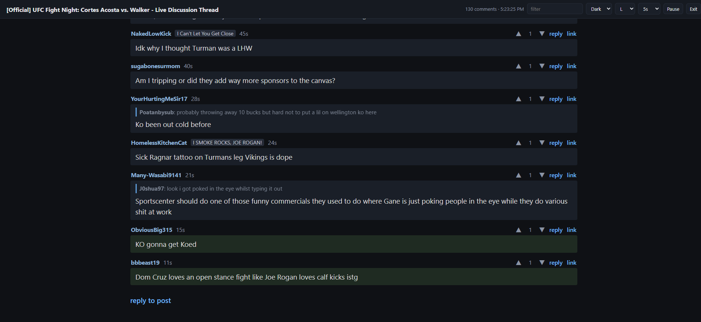

# RLC (Reddit Live Comments)

A locally hosted alternative to [reddit-stream.com](https://reddit-stream.com/). RLC turns any Reddit thread into a live, auto-updating comment feed, right in Chrome. No subscription, no server, no third-party extension, no Reddit API app. It's a tiny unpacked Chrome extension that runs entirely in your browser using your own Reddit login.

Built for UFC live discussion threads, works on any thread.



## Features

- **Live feed.** Polls the thread every 3/5/8/15s, newest comments at the bottom, new ones briefly highlighted.
- **Smart scrolling.** Sticks to the bottom while you're there. Scroll up to read and it holds your place with a "▼ N new" pill.
- **Replies included.** Collapsed "load more replies" stubs are expanded automatically, and each reply shows the comment it's answering.
- **Vote and reply inline.** ▲/▼ voting, inline reply box (Ctrl+Enter to send, Esc to cancel), and "reply to post" at the bottom.
- **Themes.** Teal (reddit-stream look), Dark, Black, Light.
- **Text size.** S / M / L / XL.
- **Filter.** Live filter by author or text.
- **One-click live thread.** On a subreddit, "⚡ Live thread" finds the stickied live discussion and opens it in stream mode.
- Settings (theme, size, refresh rate) are remembered.

## Install

1. Clone or download this repo somewhere permanent:
   ```
   git clone https://github.com/pcguywilson/rlc.git
   ```
2. Open `chrome://extensions` and turn on **Developer mode** (top right).
3. Click **Load unpacked** and select the `rlc` folder.

To update: `git pull`, then hit the reload icon on the RLC card in `chrome://extensions` and refresh any open Reddit tabs.

## Usage

You need to be logged into Reddit in Chrome.

- **On a thread:** click the **⚡ Stream** button (bottom right).
- **On a subreddit** (e.g. r/MMA on fight night): click **⚡ Live thread** to jump straight into the stickied live discussion.
- **Exit** returns to the normal thread.

Works from both new and old Reddit. On new Reddit the button hands off to `old.reddit.com`, where RLC takes over the page.

## How it works

- Polls `old.reddit.com/comments/<id>.json?sort=new` with your existing session (same-origin, so no CORS, proxy, or API key).
- Expands collapsed reply stubs via `/api/morechildren`.
- Votes and replies go through Reddit's own `/api/vote` and `/api/comment` endpoints using your session's CSRF token, exactly as old Reddit's UI does.
- Backs off automatically on errors or rate limiting.

Everything is two files: `manifest.json` and `content.js`. No build step, no dependencies.

## Permissions

RLC requests no extension permissions. It only runs as a content script on `www.reddit.com` and `old.reddit.com`, and talks only to Reddit.
